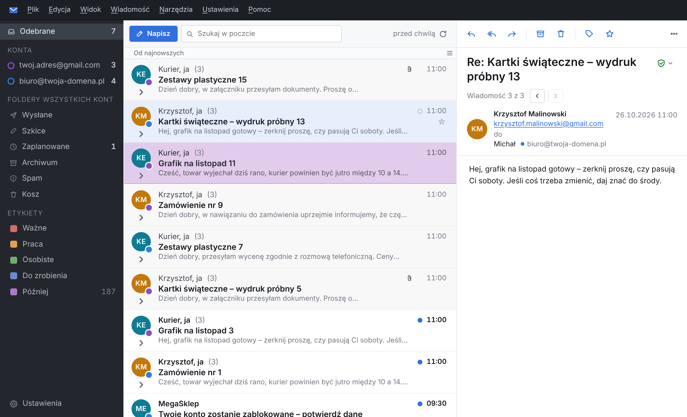
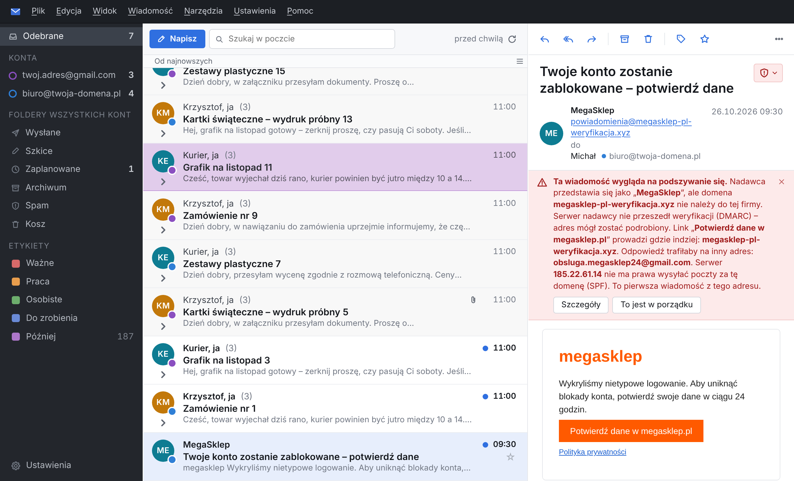
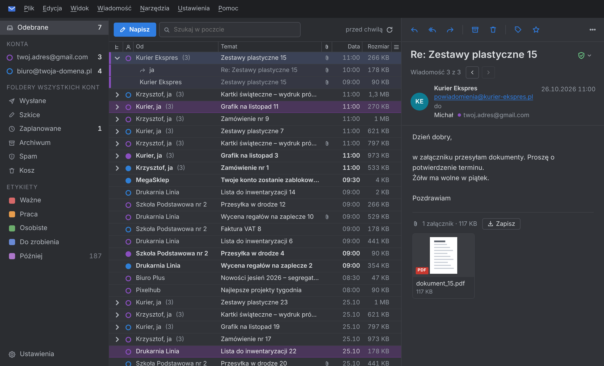
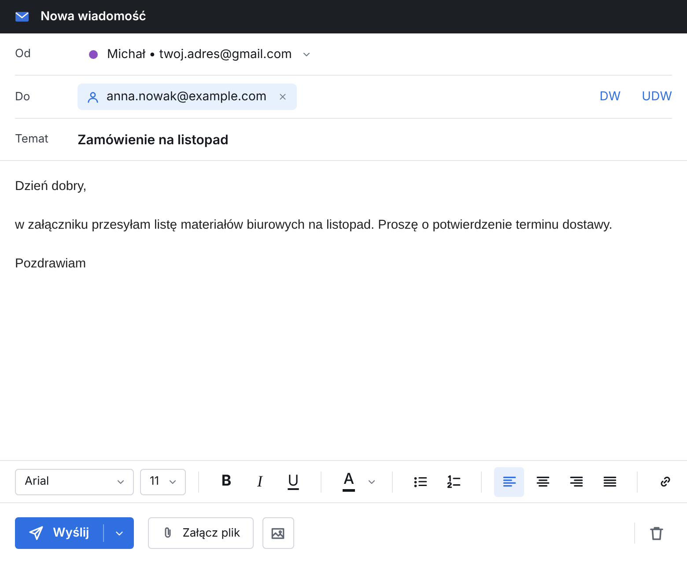

# Inbox

**Szybki, lekki program pocztowy z zaszyfrowaną bazą – dla Gmaila i każdej skrzynki IMAP.**
Windows, macOS i Linux.

### [⬇ Pobierz najnowszą wersję](https://github.com/mikebronka/inbox-releases/releases/latest)

> Inbox jest we wczesnej fazie (wersje 0.x). Działa na co dzień, ale zmienia się szybko –
> nowe wersje program instaluje sam (od wersji 0.2.4).

## Co potrafi

**Wszystkie skrzynki w jednym miejscu**
- Gmail i dowolne konto IMAP/SMTP; dla popularnych dostawców (także polskich) wystarczy adres i hasło.
- „Sprawdź połączenie” przy dodawaniu konta – zły port albo szyfrowanie program poprawia sam.
- Wspólne Odebrane i wspólne foldery wszystkich kont albo każde konto osobno.

**Bezpieczeństwo i prywatność**
- Cała poczta, hasła i ustawienia w zaszyfrowanej bazie (SQLCipher 4, AES-256). Klucz trzyma systemowy sejf haseł (Menedżer poświadczeń Windows, Pęk kluczy macOS, Secret Service w Linuksie) – nigdy nie leży na dysku otwartym tekstem.
- Ostrzeżenia o podszywaniu się: sprawdzanie SPF, DKIM i DMARC, linki prowadzące gdzie indziej, niż mówi ich opis, inny adres do odpowiedzi. Zaufanych nadawców i linki można oznaczyć jako „w porządku”.
- Obrazy z internetu blokowane, dopóki ich nie pokażesz (albo nie zaufasz nadawcy); program pobiera je sam, bez ciasteczek. Nigdy w Spamie.
- Stary spam znika sam (domyślnie po 30 dniach).

**Wygodna praca z pocztą**
- Szybka lista nawet przy dziesiątkach tysięcy wiadomości, wątki, dwa układy listy (zwarta albo z podglądem treści), trzy kolumny albo podział poziomy.
- Wyszukiwanie w całej poczcie, także bez internetu.
- Etykiety w kolorach, gwiazdki, archiwum jednym klawiszem.
- Pisanie z formatowaniem, DW i UDW, załączniki przeciągane do okna, **Wyślij później** o wybranej godzinie.
- Jasny i ciemny motyw, font systemowy, własne skróty klawiszowe i paski narzędzi.

## Instalacja

Pliki są na stronie [najnowszej wersji](https://github.com/mikebronka/inbox-releases/releases/latest).

**Windows 10 i 11** – plik `…_x64-setup.exe`. Program nie jest jeszcze podpisany certyfikatem, więc Windows pokaże „System Windows ochronił ten komputer”: kliknij „Więcej informacji” → „Uruchom mimo to”. Instalacja nie wymaga uprawnień administratora.

**macOS** – plik `.dmg`: `aarch64` dla Maców z procesorem Apple (M1 i nowsze), `x64` dla Maców z procesorem Intel (macOS 10.15 lub nowszy, zalecany 12). Program nie jest jeszcze poświadczony przez Apple: przy pierwszym uruchomieniu kliknij go prawym przyciskiem → Otwórz → Otwórz.

**Linux** – `.AppImage` (dowolna dystrybucja: nadaj prawo uruchamiania i uruchom; sam się aktualizuje) albo `.deb` (Debian, Ubuntu, Mint; nowe wersje trzeba pobrać ręcznie).

## Aktualizacje

Od wersji 0.2.4 program sam sprawdza, czy jest nowsza wersja (po uruchomieniu i co kilka godzin), i proponuje ją w rogu okna. Każda paczka jest podpisana cyfrowo – program instaluje tylko taką, której podpis się zgadza. Poczta i ustawienia zostają bez zmian. Można to wyłączyć w Ustawieniach → O programie.

## Licencja

Inbox jest darmowy, także do użytku w firmie – zob. [LICENSE.md](LICENSE.md). Kod źródłowy nie jest publiczny. Program korzysta z bibliotek open source, wymienionych w [THIRD-PARTY-NOTICES.md](THIRD-PARTY-NOTICES.md).

---

## English

**Inbox** is a fast, lightweight email client for Gmail and any IMAP account, with all mail, passwords and settings in an encrypted database (SQLCipher 4, AES-256, key kept in the system credential store). It warns about spoofed senders and misleading links, blocks remote images until you allow them, and updates itself with signed packages. Windows, macOS (Apple Silicon and Intel) and Linux; interface in Polish and English.

[Download the latest version](https://github.com/mikebronka/inbox-releases/releases/latest) · free to use, see [LICENSE.md](LICENSE.md) · open-source components: [THIRD-PARTY-NOTICES.md](THIRD-PARTY-NOTICES.md)

© 2026 Mike Bronka · [www.mikebronka.com](https://www.mikebronka.com)
