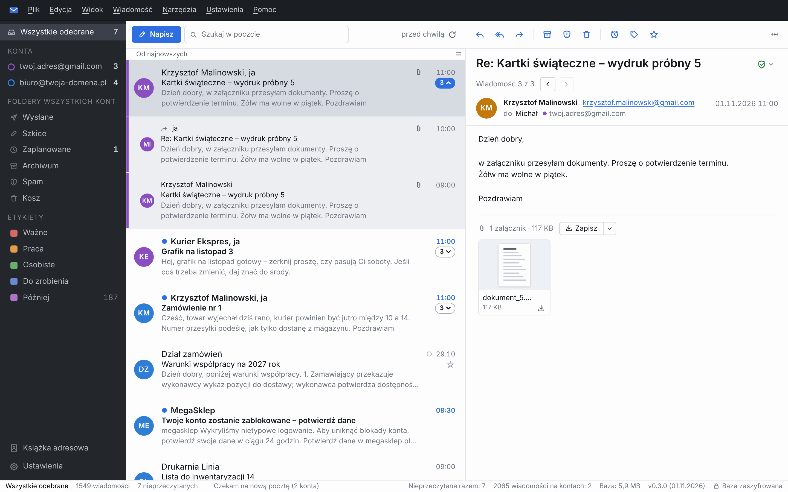
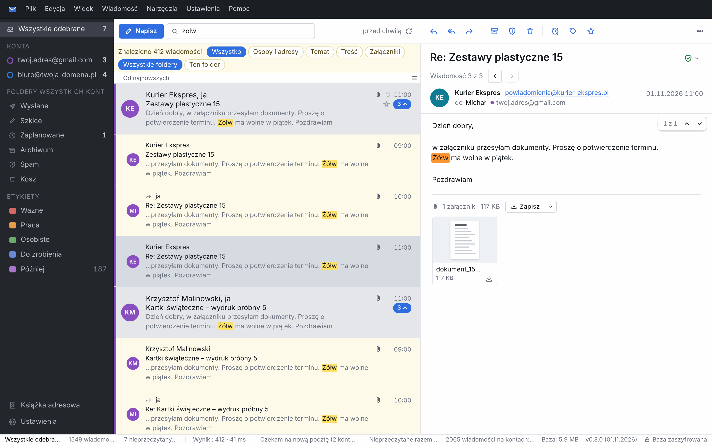
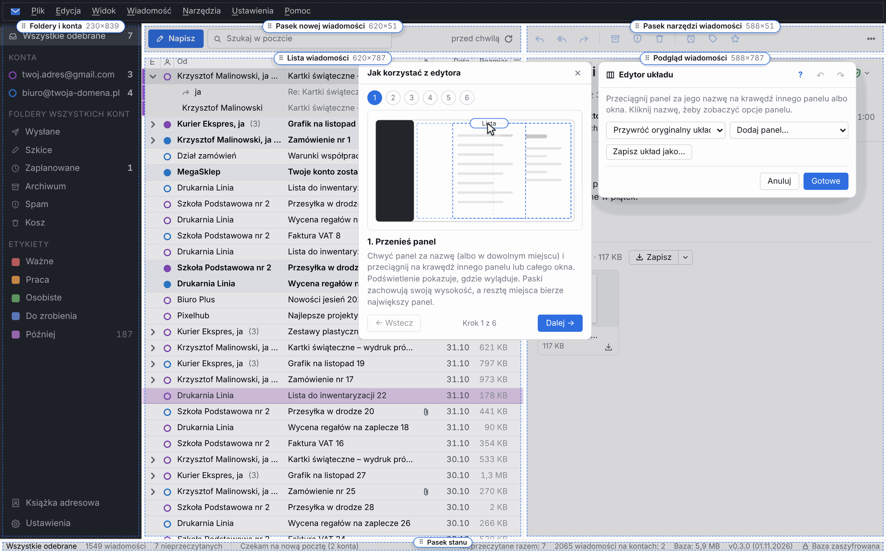
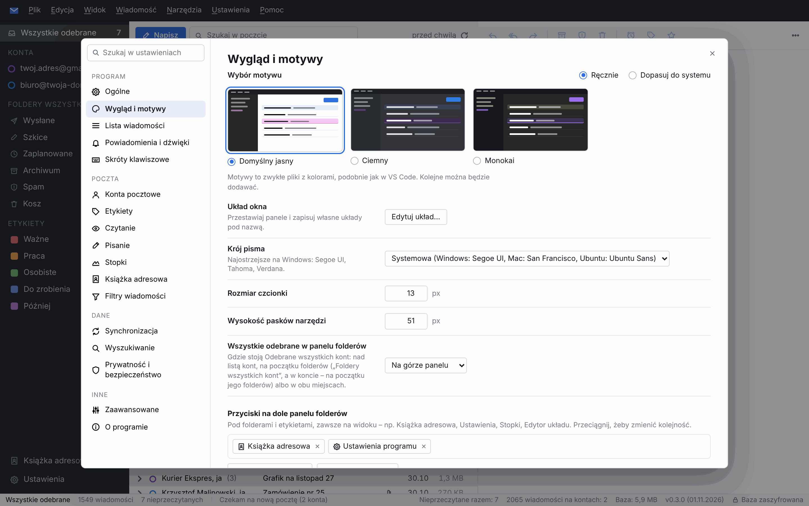
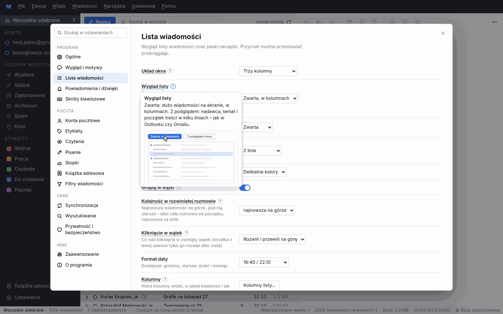
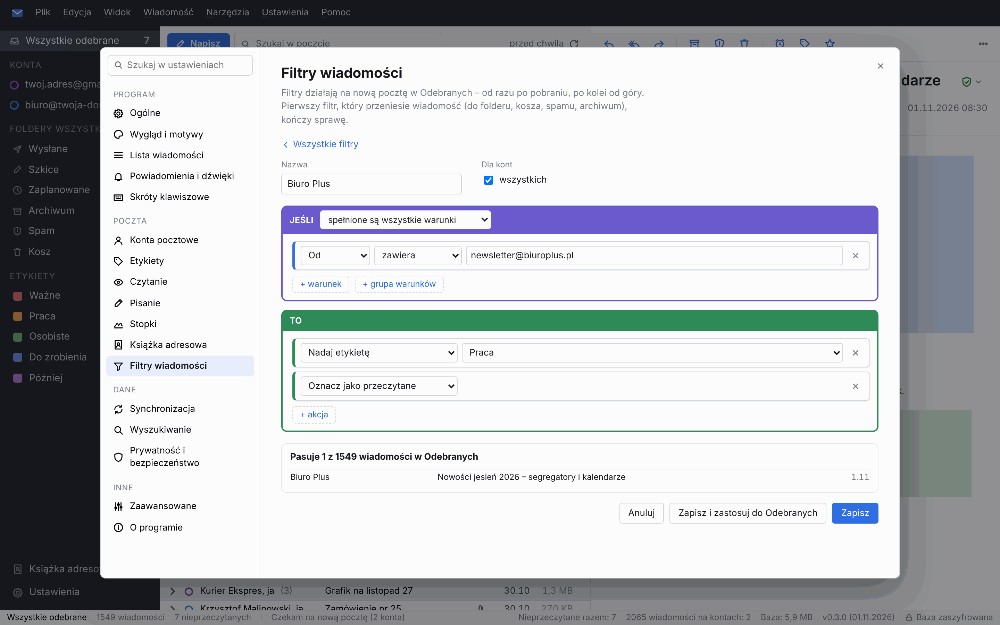
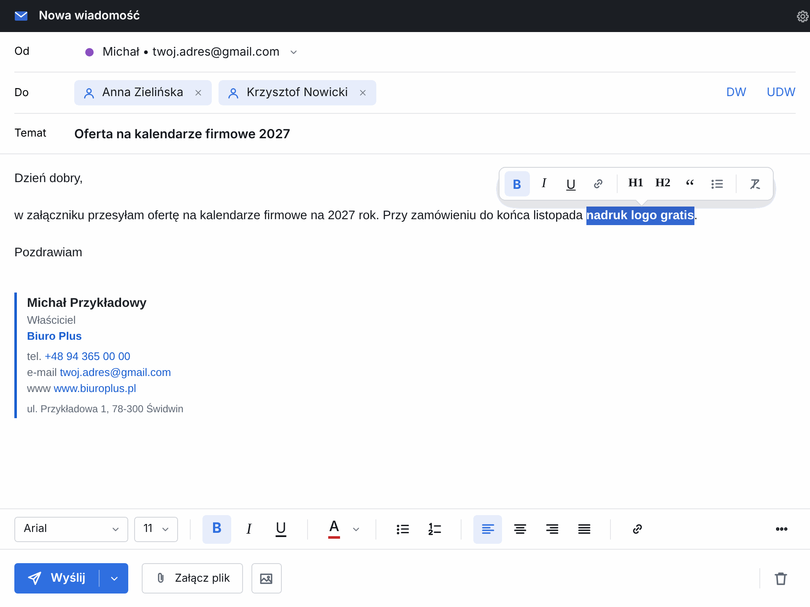
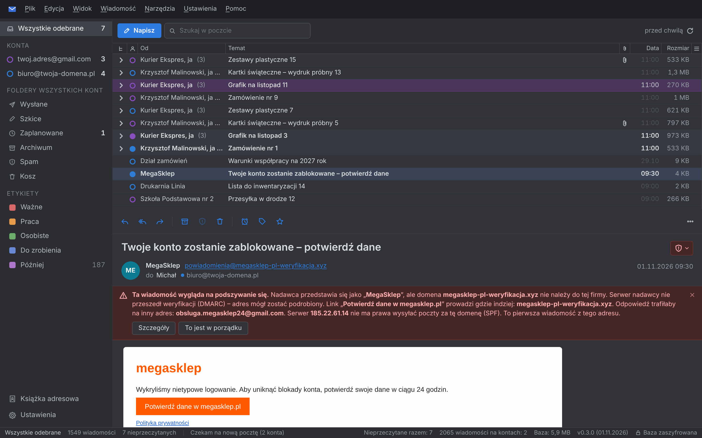

# Inbox

**Szybki, lekki program pocztowy dla Gmaila i każdej skrzynki IMAP – który ułożysz po swojemu.**
Windows, macOS i Linux · Inbox by Michał Bronka

### [⬇ Pobierz najnowszą wersję](https://github.com/mikebronka/inbox-releases/releases/latest)

> Inbox jest we wczesnej fazie (wersje 0.x): działa na co dzień, ale zmienia się szybko.
> Nowe wersje program instaluje sam.

## Szybki i lekki

- **Instalator ma kilka megabajtów** (Windows ok. 7 MB, macOS ok. 8 MB). Inbox nie wozi ze sobą
  własnej przeglądarki ani Node.js – korzysta z tej, którą ma system, więc zajmuje mało
  pamięci i miejsca.
- **Poczta jest na dysku, więc nic nie czeka na sieć.** Lista, wątki i otwieranie wiadomości
  działają od razu, także bez internetu; synchronizacja idzie w tle, nowa poczta przychodzi
  na żywo.
- **Wyszukiwanie, które znajduje wszystko.** Dowolny fragment słowa, w treści, temacie,
  adresach i nazwach załączników, w całej poczcie z wielu lat. Polskie znaki nie mają
  znaczenia – „zolw” znajdzie „Żółw”. W naszym teście na pół miliona wiadomości wyniki
  pojawiają się zwykle w kilka milisekund.

## Ułóż go po swojemu

Mało który program pocztowy daje tyle swobody – Inbox zakłada, że każdy pracuje inaczej.

- **Edytor układu.** Przeciągasz panele (foldery, lista, podgląd, paski narzędzi, pasek stanu)
  na dowolną krawędź innego panelu albo okna, zmieniasz im szerokość i wysokość, ustawiasz
  przyciski na paskach. Prawy przycisk na panelu → „Edytuj układ…” otwiera edytor od razu z
  tym panelem. Własne układy zapisujesz pod nazwą, a przewodnik z animacjami pokazuje, jak to
  działa.
- **Dwa układy okna** (trzy kolumny albo lista nad podglądem) i **dwa wyglądy listy**: zwarta w
  kolumnach jak w klasycznym programie pocztowym albo z awatarami i podglądem treści jak w
  telefonie.
- **Dopasujesz wszystko:** rozmiar czcionki, wysokość pasków, wysokość wierszy, liczbę linii
  podglądu, kolumny listy i ich kolejność, kolejność rozmowy w wątku, jasny, ciemny albo
  Monokai.
- **Przesiadka bez nauki od nowa:** zestawy skrótów klawiszowych jak w Outlooku (klasycznym i
  nowym), Thunderbirdzie, Gmailu i Apple Mail – albo własne.
- **Okno pisania też układasz:** kolejność części (np. Wyślij na samej górze), przyciski paska
  wysyłania i paska formatowania.
- Pomoc przy ustawieniach: najedź na nazwę, a dymek z krótką animacją pokaże, co zmienia.

## Porządek w poczcie bez wysiłku

- **Filtry z klocków „jeśli … to …”** – warunki i grupy warunków, kilka akcji naraz (folder,
  etykieta, przeczytane, gwiazdka, archiwum, spam, bez powiadomienia), od razu podgląd
  pasujących wiadomości i „zastosuj do tego, co już jest”. Prawy przycisk na wiadomości →
  „Utwórz filtr z tej wiadomości”.
- **Inteligentna książka adresowa** – każdy, do kogo napisałeś, trafia do niej sam; pełne karty
  kontaktów, wyszukiwanie po wszystkim (także po numerze telefonu), import i eksport vCard i
  CSV z Outlooka, Gmaila, Apple i Thunderbirda. Podpowiedzi adresów pomijają adresy no-reply.
- **Odłóż na później** – wiadomość znika i wraca jako nieprzeczytana o wybranej porze, także na
  innych komputerach.
- **Wypisz się** z newslettera jednym kliknięciem, **usuń wszystko od nadawcy**, automatyczne
  opróżnianie kosza i starego spamu.
- Etykiety w kolorach, gwiazdki, archiwum jednym klawiszem, wspólne Odebrane wszystkich kont.

**Od wersji 0.3.1: „Co zajmuje miejsce”** – mapa skrzynki jak w programach do analizy dysku:
konta, foldery i nadawcy jako prostokąty wielkości zajętego miejsca, lista największych
wiadomości i załączników z filtrami (filmy, PDF, zdjęcia, archiwa, wiek) i usuwanie kilku naraz.
Od razu widać, co skasować, żeby zmieścić się w limicie skrzynki albo na dysku laptopa.

## Pisanie

- Formatowanie, adresaci jako „pigułki”, DW i UDW, obrazki w treści, pliki przeciągane do okna.
- **Wyślij później** o wybranej porze, **cofnięcie wysyłki** (5–30 s), szkice zapisywane same.
- Stopki: pięć szablonów, zdjęcie z przycinaniem, własne pola albo własny HTML, osobna stopka
  dla każdego konta.
- Zaproszenia z kalendarza jako karta nad treścią z odpowiedzią Tak / Może / Nie; dodawanie do
  Kalendarza Google i zapis załączników na Dysku Google.

## Bezpieczeństwo i prywatność

- Cała poczta, hasła i ustawienia w zaszyfrowanej bazie (AES-256). Klucz trzyma systemowy
  sejf haseł (Menedżer poświadczeń Windows, Pęk kluczy macOS, Secret Service w Linuksie) –
  nigdy nie leży na dysku otwartym tekstem.
- **Ocena każdej wiadomości:** SPF, DKIM i DMARC, podszywanie się pod znane firmy, linki
  prowadzące gdzie indziej, niż mówi ich opis, inny adres do odpowiedzi, podejrzane załączniki.
  Program, skrypt albo dokument z makrami otwiera się dopiero po ostrzeżeniu.
- Obrazy z internetu bez ciasteczek i pikseli śledzących, nigdy w Spamie.
- Bez telemetrii, statystyk i własnych serwerów. Przed wersją 0.3.0 cały program przeszedł
  pełny audyt bezpieczeństwa – wszystko, co znalazł, jest poprawione.
- Powiadomienia o nowej poczcie z wyborem, co pokazują, godzinami ciszy i „tylko od znanych
  osób”.

## Licencja

- **Wersja darmowa** – do użytku prywatnego, z dwoma kontami pocztowymi, bez limitu czasu i bez
  reklam; działają w niej wszystkie funkcje.
- **Licencja osobista – 99 zł** (25 USD / 25 € poza Polską): jedna osoba, jej komputery,
  dowolnie wiele kont, także we własnej jednoosobowej działalności.
- **Licencja firmowa – 149 zł za stanowisko** (39 USD / 39 €): dla firm i organizacji.

Płacisz raz – licencja obejmuje wszystkie wersje 1.x, bez abonamentu. Kupisz ją na
**[inbox.mikebronka.com/buy](https://inbox.mikebronka.com/buy)**, klucz przychodzi mailem, a
wkleja się go w Pomoc → Wprowadź licencję… Program sprawdza klucz sam, bez łączenia się z
internetem. Pełne warunki: [LICENSE.md](LICENSE.md).

## Instalacja

Pliki są na stronie [najnowszej wersji](https://github.com/mikebronka/inbox-releases/releases/latest).

**Windows 10 i 11** – plik `…_x64-setup.exe`. Program nie jest jeszcze podpisany certyfikatem, więc Windows pokaże „System Windows ochronił ten komputer”: kliknij „Więcej informacji” → „Uruchom mimo to”. Instalacja nie wymaga uprawnień administratora.

**macOS** – plik `.dmg`: `aarch64` dla Maców z procesorem Apple (M1 i nowsze), `x64` dla Maców z procesorem Intel (macOS 10.15 lub nowszy). Program nie jest jeszcze poświadczony przez Apple: przy pierwszym uruchomieniu kliknij go prawym przyciskiem → Otwórz → Otwórz.

**Linux** – `.AppImage` (dowolna dystrybucja: nadaj prawo uruchamiania i uruchom; sam się aktualizuje) albo `.deb` (Debian, Ubuntu, Mint; nowe wersje trzeba pobrać ręcznie).

Na start możesz obejrzeć program na przykładowych danych, zanim dodasz własne konto.

## Aktualizacje

Program sam sprawdza, czy jest nowsza wersja (po uruchomieniu i co kilka godzin), i proponuje ją w rogu okna. Każda paczka jest podpisana cyfrowo – program instaluje tylko taką, której podpis się zgadza. Poczta, ustawienia i licencja zostają bez zmian. Można to wyłączyć w Ustawieniach → O programie.

Co się zmieniło w każdej wersji – w opisie [wydania](https://github.com/mikebronka/inbox-releases/releases).

## Prywatność

Inbox nie wysyła autorowi żadnych danych – zob. [PRIVACY.md](PRIVACY.md). Program korzysta z bibliotek open source, wymienionych w [THIRD-PARTY-NOTICES.md](THIRD-PARTY-NOTICES.md).

---

## English

**Inbox** is a fast, lightweight email client for Gmail and any IMAP account – one you can arrange your own way. Windows, macOS (Apple Silicon and Intel) and Linux; interface in Polish and English. Inbox by Mike Bronka.

**Fast and light.** A few-megabyte installer (about 7 MB on Windows, 8 MB on macOS): no bundled browser or Node.js, it uses the system web view, so it needs little memory and disk. All mail is stored locally, so lists, threads and messages open instantly, even offline, while sync runs in the background and new mail arrives live. **Search finds anything**: any fragment of a word, in bodies, subjects, addresses and attachment names, across years of mail, with accents ignored ("zolw" finds "Żółw") – typically a few milliseconds on half a million messages in our benchmark.

**Arrange it your way.**
- **Layout editor** – drag panels (folders, list, preview, toolbars, status bar) to any edge of another panel or the window, resize them, arrange toolbar buttons; right-click a panel → "Edit layout…"; save named layouts; an animated guide shows how.
- Two window layouts (three columns or list above preview) and two list styles (compact columns, or avatars with a preview of the text).
- Text size, toolbar heights, row height, preview lines, list columns and their order, thread order, light, dark or Monokai themes.
- **Coming from another program?** Shortcut sets like Outlook (classic and new), Thunderbird, Gmail and Apple Mail – or your own.
- A customisable compose window (order of its parts, buttons of its bars), and animated help next to settings.

**Order without effort.** Block-based filters ("if … then …", groups of conditions, several actions at once) with a live preview of matching mail and "apply to existing"; a smart address book (everyone you wrote to, full contact cards, vCard/CSV import from Outlook, Gmail, Apple and Thunderbird); snooze, one-click unsubscribe, "delete everything from this sender", coloured labels, unified inbox. **From 0.3.1: "What takes up space"** – a treemap of your mailbox by account, folder and sender, plus the largest messages and attachments with filters, so you see at once what to delete.

**Writing.** Formatting, recipients as chips, send later, undo send (5–30 s), drafts saved automatically, signatures with templates and photo, calendar invitations with Yes / Maybe / No, Google Calendar and Google Drive.

**Security and privacy.** All mail, passwords and settings in an encrypted database (AES-256, key kept in the system credential store). Every message is checked: SPF, DKIM and DMARC, impersonated brands, links that lead somewhere else than they say, risky attachments. Remote images without cookies or tracking pixels. No telemetry, no servers of our own; a full security audit before 0.3.0. Notifications with quiet hours.

**Licence.** Free version for private use with two mail accounts, no time limit, every feature. Personal licence $25 / 25 € (one person, any number of accounts), business licence $39 / 39 € per seat – pay once, covers every 1.x version. Buy at [inbox.mikebronka.com/buy](https://inbox.mikebronka.com/buy); the key is checked offline. Terms: [LICENSE.md](LICENSE.md).

[Download the latest version](https://github.com/mikebronka/inbox-releases/releases/latest) · [privacy](PRIVACY.md) · open-source components: [THIRD-PARTY-NOTICES.md](THIRD-PARTY-NOTICES.md)

© 2026 Mike Bronka · [www.mikebronka.com](https://www.mikebronka.com)
