# Inbox

**A fast, lightweight email client for Gmail, Outlook.com, iCloud, Yahoo and any IMAP or POP3 mailbox – one you arrange your own way.**
Windows, macOS and Linux · by Mike Bronka

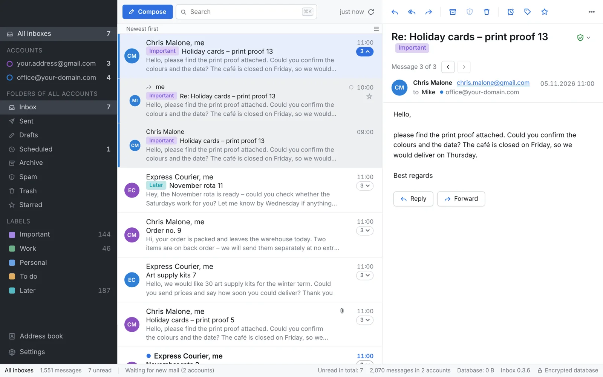

### [⬇ Download the latest version](https://github.com/mikebronka/inbox-releases/releases/latest) · [Website](https://inbox.mikebronka.com) · [Documentation](https://inbox.mikebronka.com/docs)

> Inbox is in its early versions (0.x): it is used every day, but it changes quickly.
> The program installs new versions by itself.

## Fast and light

- **A few-megabyte installer** (about 7 MB on Windows, 8 MB on macOS). Inbox does not carry its
  own browser or Node.js – it uses the one the system has, so it needs little memory and disk.
- **Your mail is on your disk, so nothing waits for the network.** The list, threads and
  messages open at once, offline too; sync runs in the background and new mail arrives live.
- **Search that finds everything.** Any part of a word, in the text, subjects, addresses and
  attachments – their names and what is inside them (PDF, Word, Excel, PowerPoint,
  OpenDocument), across years of mail. Accents and capitals don't matter – "cafe" finds "Café".
  In our test on half a million messages, results usually appear within a few milliseconds.

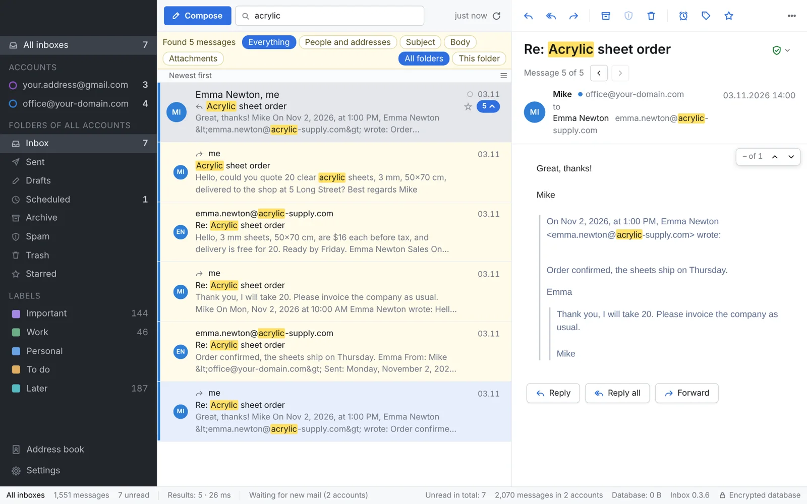

## Arrange it your way

Few email clients give you this much freedom – Inbox assumes everyone works differently.

- **The layout editor.** Drag panels (folders, list, message, toolbars, status bar) to any edge
  of another panel or of the window, resize them, arrange the buttons on the bars. Right-click a
  panel → "Edit layout…" opens the editor with that panel already picked. Save your layouts by
  name; an animated guide shows how it works.
- **Two window layouts** (three columns, or the list above the message) and **two list styles**:
  compact columns like a classic mail program, or avatars with a preview of the text like on a
  phone.
- **Labels the way you read best:** pills by the subject, soft pastel rows, full colour or
  coloured text – up to 50 labels with your own names and colours.
- **18 themes**, an accent colour on any of them, your own themes – and **any VS Code theme**,
  imported from its file.
- **Moving from another program?** Keyboard shortcut sets like Outlook (classic and new),
  Thunderbird, Gmail and Apple Mail – or your own.
- **Help that shows you:** hover over a setting and a bubble with a short animation shows what it
  changes.

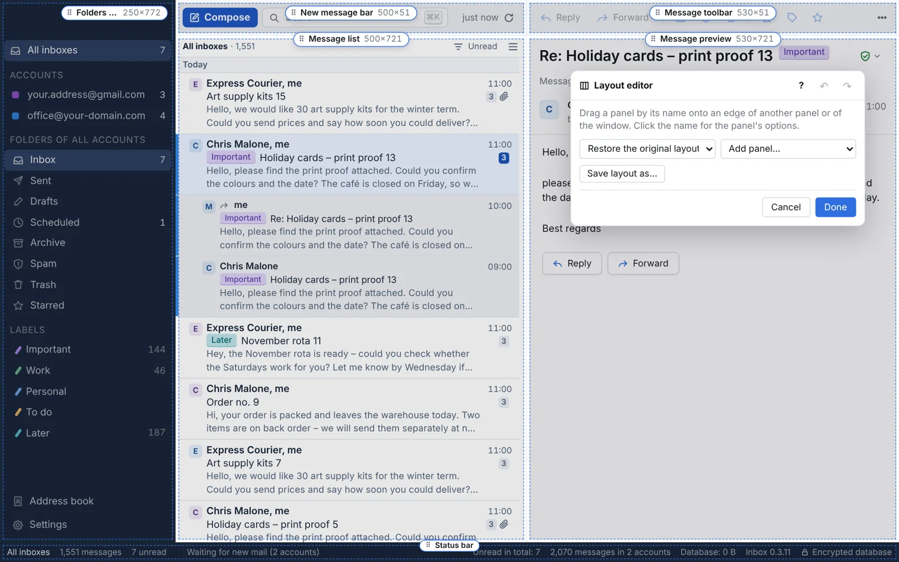

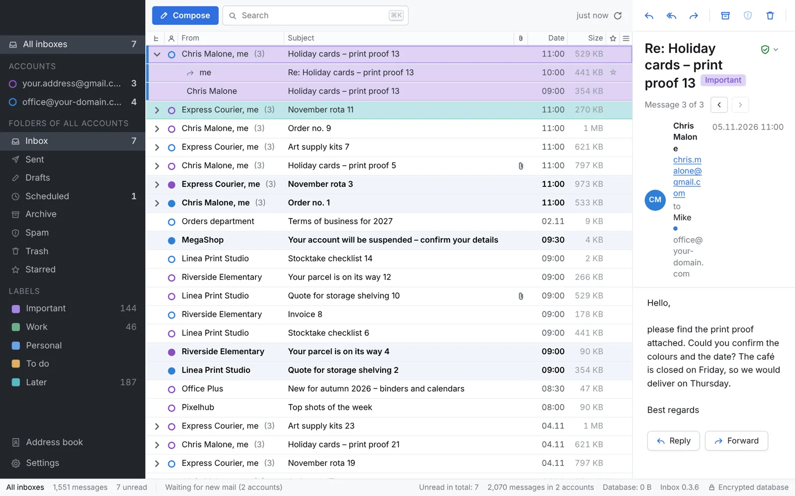

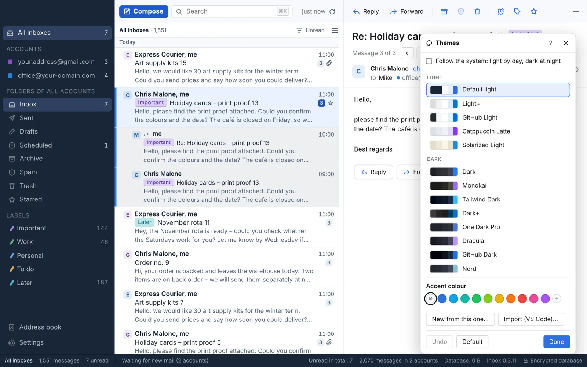

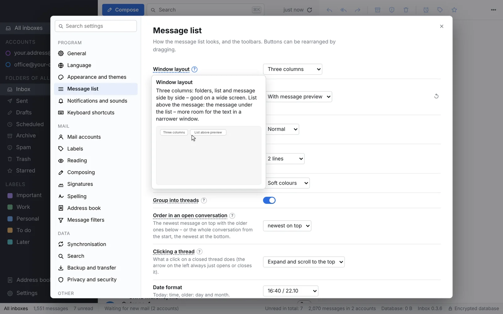

## Order without effort

- **"If … then …" filters built from blocks** – conditions and groups of conditions, several
  actions at once (folder, label, read, star, archive, spam, no notification), a live preview of
  matching mail and "apply to what is already there". They can run on the server too (Sieve,
  Gmail filters), so they work while your computer is off.
- **A smart address book** – everyone you write to is in it by itself; full contact cards,
  search through everything (phone numbers too), vCard and CSV import and export from Outlook,
  Gmail, Apple and Thunderbird. Address suggestions leave out no-reply addresses.
- **Snooze** – a message goes away and comes back unread at the time you pick, on your other
  computers too.
- **One-click unsubscribe**, **delete everything from a sender**, Trash and old spam emptied by
  themselves, a Starred folder across all accounts, a unified inbox.
- **What takes up space** – a map of your mailbox by account, folder and sender, with the largest
  messages and attachments, so you see at once what to delete to fit your mailbox limit or your
  laptop's disk.

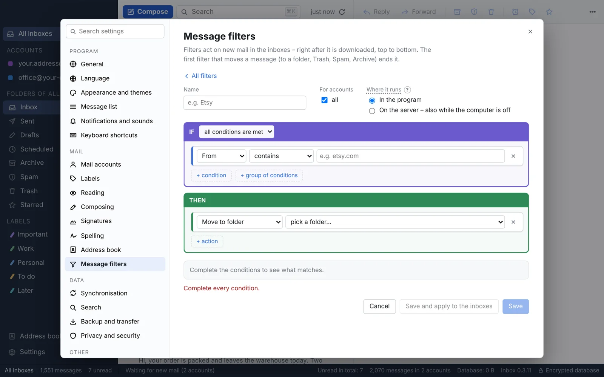

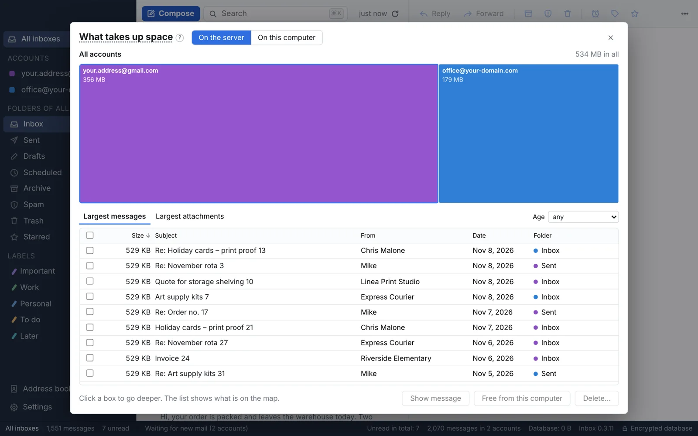

## Writing and printing

- Formatting, recipients as pills, Cc and Bcc, pictures in the text, files dragged into the
  window, spell checking in several languages at once.
- **Send later** at a chosen time, **undo send** (5–30 s), drafts that save themselves.
- **Reply templates** with fields for the name and the date, put in from a menu or Ctrl+Shift+T.
- Signatures: five templates, a cropped photo, your own fields or your own HTML, a signature for
  each account.
- Calendar invitations as a card above the message with Yes / Maybe / No; Google Calendar and
  saving attachments to Google Drive.
- **Printing with a page preview:** paper sizes, presets, whole threads without repeated quotes,
  and on Windows straight to the printer.

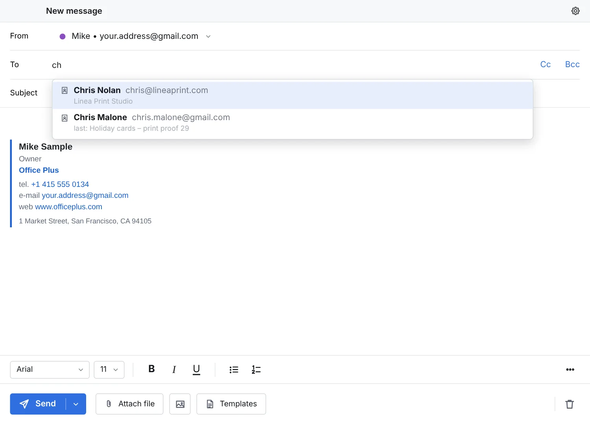

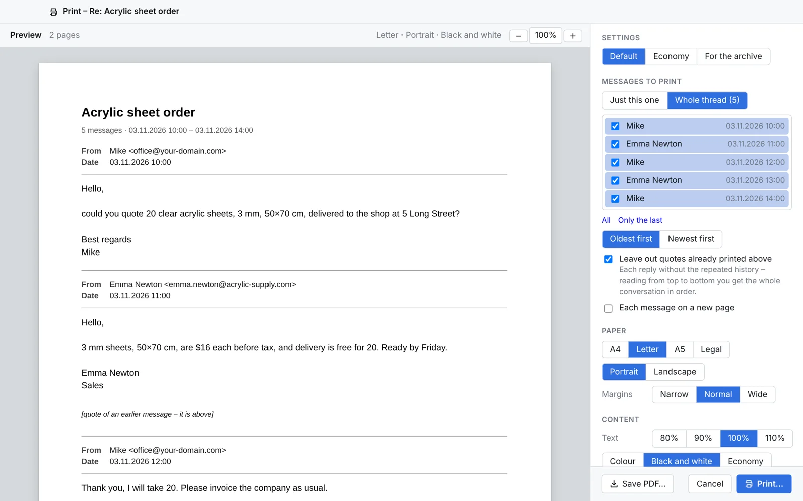

## Security and privacy

- All mail, passwords and settings in an encrypted database (AES-256). The key is kept by the
  system's password store (Windows Credential Manager, the macOS Keychain, the Secret Service on
  Linux) – never in plain text on disk. Want more? **A password at startup** locks the program
  itself, also after time away.
- **Sign in with Google or Microsoft** on their own page – the program never sees the password.
- **Every message is checked:** SPF, DKIM and DMARC, impersonated brands, links that lead
  somewhere other than they say, a different reply-to address, suspicious attachments. A
  program, script or document with macros opens only after a warning.
- Pictures from the internet without cookies or tracking pixels, never in Spam.
- Encrypted backups in one file and encrypted settings sync between your computers.
- No telemetry, no statistics, no servers of our own. Before version 0.3.0 the whole program
  went through a full security audit – everything it found is fixed.

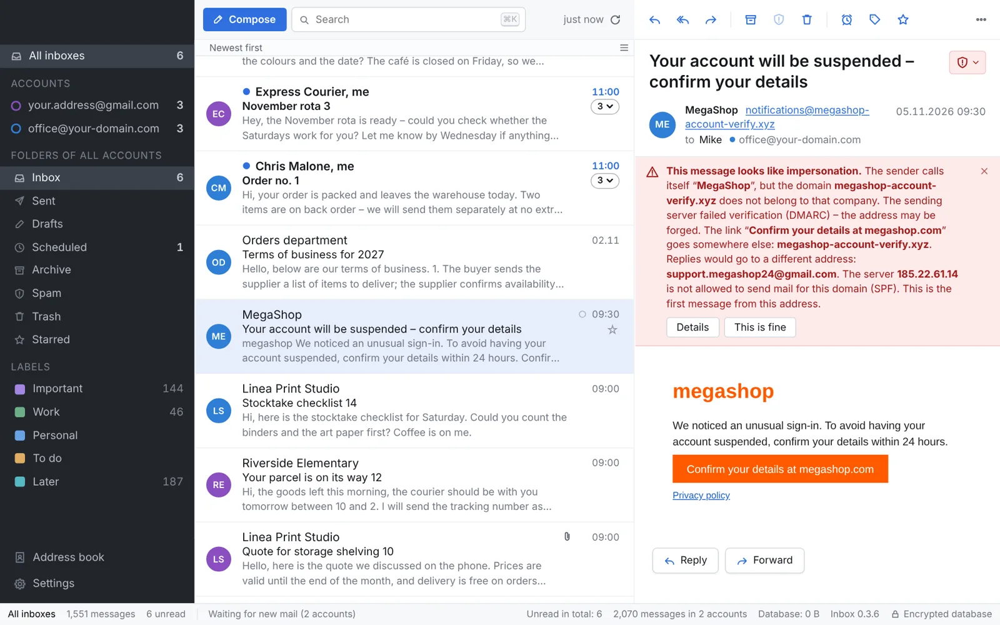

## Licence

- **Free version** – for private use, with two mail accounts, no time limit and no ads; every
  feature works in it.
- **Personal licence – $25 / 25 €** (99 zł in Poland): one person, their own computers, any
  number of accounts – for private use, at home or anywhere.
- **Business licence – $39 / 39 € per seat** (149 zł in Poland): for companies, sole traders
  included, and organisations – whenever the program is used for work in a business or bought
  by a business (with a VAT invoice).

Pay once – the licence covers every 1.x version, no subscription. Buy it at
**[inbox.mikebronka.com/buy](https://inbox.mikebronka.com/buy)**; the key arrives by email and is
pasted in Help → Enter licence… The program checks the key itself, without connecting to the
internet. Full terms: [LICENSE.md](LICENSE.md).

## Installation

The files are on the page of the [latest version](https://github.com/mikebronka/inbox-releases/releases/latest).

**Windows 10 and 11** – the `…_x64-setup.exe` file. The program is not code-signed yet, so Windows shows "Windows protected your PC": click "More info" → "Run anyway". Installing needs no administrator rights.

**macOS** – the `.dmg` file: `aarch64` for Macs with an Apple processor (M1 and later), `x64` for Macs with an Intel processor (macOS 10.15 or newer). The program is not notarised by Apple yet: the first time macOS refuses to open it – go to System Settings → Privacy & Security, click "Open Anyway" and confirm with your password (on macOS 14 and older: right-click the program → Open → Open).

**Linux** – `.AppImage` (any distribution: make it executable and run it; it updates itself) or `.deb` (Debian, Ubuntu, Mint; new versions are downloaded by hand).

You can look around the program with sample data before you add your own account.

## Languages

English is built in. Polski, Deutsch, Français, Español, Italiano, Português (Brasil), Nederlands, Čeština, Українська and Русский are signed language packs – translation and spelling dictionary together – downloaded when you choose one in Settings → Language.

## Updates

The program checks for a newer version by itself (at start and every few hours) and offers it in the corner of the window. Every package is digitally signed – the program installs only one whose signature checks out. Your mail, settings and licence stay as they are. This can be switched off in Settings → About.

What changed in each version is in the notes of each [release](https://github.com/mikebronka/inbox-releases/releases).

## Privacy

Inbox sends the author no data – see [PRIVACY.md](PRIVACY.md). The program uses open-source libraries, listed in [THIRD-PARTY-NOTICES.md](THIRD-PARTY-NOTICES.md).

---

© 2026 Mike Bronka · [www.mikebronka.com](https://www.mikebronka.com)
